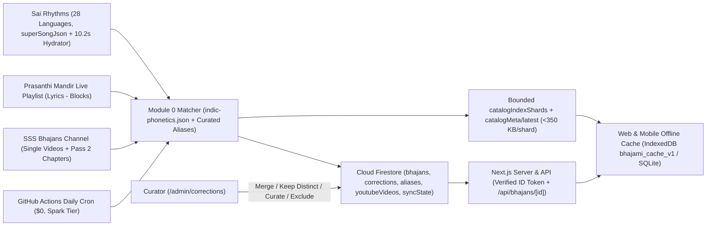

# bhaJami Cloud Catalog, Sanskrit Equivalence & Daily Curation Design

*   **Author:** Sri Pasumarthi
*   **Status:** Approved
*   **Date:** 2026-11-24

--------------------------------------------------------------------------------

## Overview

bhaJami is a devotional bhajan practice and reference studio built on Next.js (`apps/web`), shared TypeScript domain packages (`packages/shared`), Python ingestion scripts (`tools/catalog-pipeline`), and Firebase project `saibhajanverse`, with upcoming Android and iOS clients. This design replaces the current flat local JSON catalog (`662` mostly placeholder records) with a Firestore-backed multi-source catalog fed by Sai Rhythms (`sairhythms.sathyasai.org/songs`), the Prasanthi Mandir Live YouTube playlist (`PLC4MvBXcP7HJS5hkJufdFZzQsfJBzQMBc`), and the Sri Sathya Sai Bhajans YouTube channel (`UCWW5Z9BGsa14XLFXdRf01TA`), linked together by a zero-LLM Sanskrit transliteration equivalence matcher and a human-in-the-loop curation workbench.

## The Problem

Right now, `packages/shared/data/catalog.json` holds `662` bhajans (`1.05 MB`), of which only `10` contain verified Sai Rhythms lyrics, notation, pitches, and multi-language scripts. The remaining `652` entries are stubs generated from `761` local MP3 filenames on a personal Mac (`/Users/chax/Downloads/...`) filled with synthetic placeholders (`"Pending Sai Rhythms Sync"`, default pitches, and generic liner notes). Several technical and editorial constraints block scaling this catalog to all Sai bhajans:

1. **Transliteration drift across sources**: The same Sanskrit word is spelled differently across Sai Rhythms, YouTube video titles, YouTube lyric descriptions, and local filenames (for instance, `Naaraayana`, `Narayana`, `Naarayana`, and `Narayan`), while distinct words differ by a single vowel (`Deva` vs. `Devi`, `Hara` vs. `Hari`). Naive string equality misses duplicates, while overly loose fuzzy matching creates false merges.
2. **Storage, quota, and client load limits**: Shipping `3,000–5,000+` full 28-language bhajan documents in one payload (`15–30 MB`) stalls page load and breaks Firestore's `1 MiB` document limit, whereas fetching every document directly on app startup burns Firestore Spark's `50,000` free daily reads within ~10 user sessions.
3. **Rule and schema gaps**: Current `firestore.rules` cap `lyricsSets <= 20` (below Sai Rhythms' 28 languages), `recordings <= 50`, `originalLyrics`/`proposedLyrics` `<= 80`, and `isValidBhajanRevision` lines `<= 80`; omit notation fields in `isValidProposedMetadata`; leave `PATCH /api/corrections/[id]` without server Firebase ID token admin verification; and split overrides across local disk files and a `limit: 200` Firestore query.
4. **Playlist/channel noise and YouTube Terms of Service**: `UCWW5Z9BGsa14XLFXdRf01TA` mixes single bhajans with long compilation volumes/medleys whose titles all contain `"Sathya Sai Bhajans"` alongside catalog numbers and typos (`"Sri Sathya Sai Bbajans"`), and whose descriptions omit lyrics. Using `<audio>` extraction or unverified `?t=` embeds violates YouTube API Terms of Service or fails to stop at chapter boundaries.
5. **No daily cloud ingestion or missing-metadata workflow**: Sync currently depends on manual local scripts, and synthetic placeholders hide which bhajans are missing English meaning, pitch, raga, notation, or verified lyrics.

## Goals

*   **Exhaustive Multi-Source Cloud Catalog**: Populate `saibhajanverse` Cloud Firestore as the single source of truth across Sai Rhythms (28 languages), Prasanthi Mandir Live (`PLC4MvBXcP7HJS5hkJufdFZzQsfJBzQMBc`), and single + timestamped-chapter videos from `UCWW5Z9BGsa14XLFXdRf01TA`, accessible from both Web and future Android/iOS apps.
*   **Deterministic Sanskrit Equivalence & Curated Learning (Zero Runtime LLMs)**: Reconcile spelling variants across transliterated English titles and lyrics using deterministic phonetic canonicalization, stopword-weighted similarity, conservative negative-collision guards, and human-approved `entityAliases` / `doNotMergePairs` stored cleanly without mutating edit-distance weights.
*   **Zero-Cost Cloud Operation Over Multi-Week Rollout**: Keep ongoing Firebase usage strictly on the **Spark** free tier (`<= 50k` reads/day, `<= 20k` writes/day) and run daily incremental sync via **GitHub Actions scheduled cron** + YouTube Data API v3 (`10,000` free units/day), throttling initial backfill writes over several weeks with zero billing card required.
*   **Compliant, High-Signal Ingestion**: Honor `sairhythms.sathyasai.org/robots.txt` `Crawl-delay: 10` using `>= 10.2s` request spacing, filter YouTube compilations cleanly using duration (`> 390` seconds / `6.5 min` scrutiny), explicit volume keywords (`medley`, `collection`, `vol`, `volume`), and chapter markers (`>= 2`), record `status.embeddable` per track, and render official visible YouTube IFrame players (`?start=&end=`).
*   **Daily Curator Queue & Community Enrichment**: Eliminate synthetic placeholder strings in favor of explicit missing-field markers; cross-match `UCWW5Z9BGsa14XLFXdRf01TA` titles against Sai Rhythms first; surface `Needs Verification (Doubt)` and `lyricsMissing` bhajans alongside the embedded player in `/admin/corrections`; and provide a logged-in **`Complete Missing Metadata`** button in Jam Studio for community suggestions.
*   **Incremental Phase Delivery with GitHub Checkpoints**: Split implementation into bounded phases (1–2 sessions each) to reduce context and quota pressure (pausing with a timer/checkpoint whenever quota headroom runs low) and push each verified phase to the author's GitHub repository.

## Non-Goals

*   Executing LLM inference at runtime during bhajan search, daily sync, or matching passes.
*   Downloading, scraping, transcoding, or proxying YouTube audio streams into HTML5 `<audio>` elements, or playing YouTube embeds inside hidden/undersized frames.
*   Training or mutating floating-point character edit weights from admin clicks.
*   Publishing the 761 personal local Mac MP3 files (`/Users/chax/Downloads/...`) to public users unless explicitly opted into cloud storage later.
*   Upgrading `saibhajanverse` to the Firebase Blaze plan or deploying paid cloud infrastructure during initial buildout.

## Open Questions

*   **Question 1 — Target GitHub Repository & Git Identity for Phase Checkpoints (`PARTIALLY RESOLVED`)**: Resolved GitHub account `eezyal`, commit email `nfschax@gmail.com`, and target repository URL `https://github.com/eezyal/bhajami`. Note: Agent Marketplace currently has no GitHub MCP plugin and `gh` CLI is not installed locally, so repository visibility (`public` for unlimited `$0` GitHub Actions minutes vs. `private` with `2,000` free min/month) and remote repo creation at `https://github.com/eezyal/bhajami` remain pending before the first `git push`.
*   **Question 2 — Disposition of Local Mac MP3 Archives (`/Users/chax/Downloads/...`)**: Gated behind `LOCAL_ARCHIVE_ENABLED=true` for local development by default; public users receive Sai Rhythms audio, community uploads, and embedded YouTube recordings unless an opt-in cloud upload script is requested later.
*   **Question 3 — Moderator `Reject` UI Policy (`RESOLVED`)**: Expose a **`Reject Submission`** button in `/admin/corrections` requiring a non-empty rejection reason in the moderator note box, email the proposer (`dispatchContributorRejectionEmail`) with the rejection reason and a direct `/?respondTo=<id>` follow-up communication link, and allow authenticated submitters to reply on `status in ['info_requested', 'rejected']`.

## Critical User Journeys (CUJs)

### CUJ 1: Web or Mobile Devotee Searches and Opens a Multi-Language Bhajan Within Spark Quotas

*   **Given**: The catalog holds `3,000–5,000+` bhajans across Sai Rhythms (up to 28 languages) and YouTube sources in `saibhajanverse`, and the client holds an older cached slim search index in IndexedDB (`bhajami_cache_v1` on Web) or SQLite (Android/iOS).
*   **When**: The user opens the app, filters by deity or searches `"narayana"`, and selects a bhajan with 28 script tabs and embedded recordings.
*   **Then**: The client performs `1` lightweight version check against `catalogMeta/latest`, refreshes bounded Firestore `catalogIndexShards/{shardId}` only if `version` changed (`0` full `bhajans` collection scans), filters locally over canonical/phonetic tokens, fetches the single `bhajans/{id}` detail document once (`1` read, cached in IndexedDB/SQLite), and renders all language tabs plus a visible YouTube IFrame or `<audio>` player.

### CUJ 2: Unattended Cloud Daily Sync Ingests New Prasanthi Mandir Live Offerings

*   **Given**: `saibhajanverse` has a valid YouTube Data API v3 key and service account stored in GitHub Actions secrets, and a new bhajan recording was posted to `PLC4MvBXcP7HJS5hkJufdFZzQsfJBzQMBc` with a `Lyrics -` block in the video description.
*   **When**: The scheduled GitHub Actions daily workflow triggers in the cloud and compares recent playlist items against the Firestore `syncState/{source}` watermark.
*   **Then**: The worker fetches `snippet`, `contentDetails`, and `status` in batched `videos.list` calls, extracts lyrics, runs Module 0 against Sai Rhythms and `entityAliases` (checking `doNotMergePairs`), attaches the embeddable YouTube video (`youtubeVideoId`, `embeddable: true`) onto a matched Sai Rhythms bhajan or creates a new `bhajans/{id}` entry if unmatched (`lyrics` populated, missing metadata flagged), updates `catalogMeta/latest`, `catalogIndexShards`, and `ingestionRuns/{runId}`, and uses `< 20` API units and `< 500` Firestore writes without local Mac involvement.

### CUJ 3: Daily Curator Reviews Missing-Lyrics and Doubtful-Match SSS Bhajans Entries

*   **Given**: Backfill/daily ingestion from `UCWW5Z9BGsa14XLFXdRf01TA` matched high-confidence single bhajans onto Sai Rhythms entries, flagged `0.72–0.89` or ambiguous title matches as `Needs Verification (Doubt)`, and saved unmatched single videos (without descriptions) as `lyricsMissing: true`.
*   **When**: The admin opens `/admin/corrections` -> Daily Curation Queue, filters by `Needs Verification (Doubt)` or `Missing Lyrics`, plays the embedded YouTube IFrame video on the left pane, and accepts a suggested merge, dismisses non-bhajan content, or edits lyrics and metadata before publishing.
*   **Then**: Published updates save atomically to Firestore `bhajans/{id}` (clearing `lyricsMissing`, setting `bhajamiOverride: true`, and updating `missingFields`), update `entityAliases` or `doNotMergePairs`, rebuild affected `catalogIndexShards` + bump `catalogMeta/latest`, and remain protected against overwrites on subsequent daily syncs.

### CUJ 4: Secondary Pass Links Timestamped Bhajan Volumes Without Playback Bleed

*   **Given**: Regular single-bhajan scrubbing for the day has completed, and a `UCWW5Z9BGsa14XLFXdRf01TA` video was classified as a `volume` (`durationSec > 390`, medley/collection/volume title markers, and `>= 2` non-structural song chapter timestamps in its description).
*   **When**: The secondary volume pass parses chapter start timestamps, infers each segment's end time (`nextStartSec` or total video `durationSec`), and runs high-precision title matching (`>= 0.90` or verified alias) exclusively against existing bhajans in `catalogIndexShards`.
*   **Then**: Each matched bhajan receives an idempotent chapter recording entry (`yt_<videoId>_t<startSec>`, `startSec`, `endSec`, `embeddable: true`) that opens directly at `startSec` inside the YouTube player and stops at `endSec`, while unmatched chapter fragments are logged without polluting live entries.

### CUJ 5: Logged-In Community Contributor Completes Missing Metadata

*   **Given**: A bhajan imported from Prasanthi Mandir Live or SSS Bhajans has verified lyrics (`or missing alternate script`), but `missingFields` shows absent English meaning, Gents/Ladies reference pitch, raga, notation (`firstLineNotes`), or alternate script lyrics.
*   **When**: A visitor clicks the contextual **`Complete Missing Metadata`** button on the bhajan card, completes non-anonymous Firebase sign-in (if guest or signed out), fills in one or more targeted missing fields in `SuggestCorrectionDialog`, and submits.
*   **Then**: `POST /api/corrections` derives `submitterUid` strictly from the verified Firebase ID token, validates notation and metadata keys under `firestore.rules`, notifies admin + queue, and leaves existing Sai Rhythms metadata untouched while awaiting moderator approval in `/admin/corrections`.

--------------------------------------------------------------------------------

## Technical Plan (Architecture)

The architecture replaces the monolithic local JSON pipeline with four connected layers running at zero hosting spend on the Firebase Spark tier: (1) a schema-unified Cloud Firestore store plus bounded Firestore index shards and offline device seed, (2) a shared deterministic Sanskrit transliteration engine with human-curated aliases and exclusions, (3) resumable CLI and GitHub Actions ingestion pipelines across Sai Rhythms and two YouTube sources, and (4) an authenticated Next.js / upcoming mobile frontend with a TOS-compliant visible YouTube player and Daily Curation Workbench.

### 1. Data Architecture, Schema Unification & Index/Detail Delivery

1. **Canonical `Bhajan` & `RecordingSource` Schema (`packages/shared/src/types.ts`)**:
   * **Eliminate Placeholder Fabrication**: Convert non-verified metadata fields (`meaning`, `raga`, `beat`, `tempo`, `gentsPitch`, `ladiesPitch`, `firstLineNotes`, `notesRange`, `sheetMusicUrl`, `sourceUrl`) to optional/nullable fields instead of synthetic fallback strings (`"Pending Sai Rhythms Sync"`, `"8 Beat / Keherwa (Est.)"`, `"2 Pancham / D"`). Add `isEstimated`, `lyricsMissing`, `matchStatus`, `matchCandidates`, `missingFields` (computed via `getMissingBhajanFields`), `slugAliases` (preserving saved favorites across merges), and expanded `metadataSource`.
   * **Expanded Script Enum**: Expand `LyricsSet.script` to 14 explicit script identifiers covering Sai Rhythms' 28 languages and fix `inferScriptKind(lines, scriptLabel, alternateKind)` to inspect Unicode code-point blocks on `lines` before falling back to labels.
   * **YouTube-Ready `RecordingSource`**: Expand `RecordingCollection` with `'youtube_prasanthi_mandir_live'`, `'youtube_sss_bhajans'`, and `'youtube_volume_chapter'`. Add `youtubeVideoId`, `startSec`, `endSec`, `embeddable`, `channelId`, `durationSec`, `matchScore`, `matchMethod`, and `lastVerifiedAt`. Require `LOCAL_ARCHIVE_ENABLED=true` to serve personal `/Users/chax/Downloads/...` `localPath` recordings so cloud web and mobile builds never surface unreachable file URLs.

2. **Two-Tier Search Index + Lazy Detail Read Strategy**:
   * **Slim Search Index Storage**: `index_builder.py` (and Phase 5 CI `daily-catalog-sync.yml`) writes a local offline seed at `packages/shared/data/catalog-index.v1.json` **and** publishes mandatory bounded shards into Firestore `catalogIndexShards/{shardId}` (`<= 350 KB` UTF-8 per document, ~`4–6` docs for `5,000` bhajans) plus `1` manifest doc at `catalogMeta/latest`. Web clients check `catalogMeta/latest.version` (`1` read), cache `CatalogIndexPayload` in IndexedDB (`bhajami_cache_v1`), and pull shards via `/api/bhajans` only when stale. During Phase 1B (before Phase 3 populates `catalogMeta/latest`), `getCatalogIndex()` projects `CatalogIndexPayload` (and `stats`) dynamically from `packages/shared/data/catalog.json` merged with Cloud Firestore overrides/new bhajans.
   * **Lazy Detail Fetch**: Selecting a bhajan fetches `GET /api/bhajans/[id]` (web) or `bhajans/{id}` (Android/iOS SDK) — `1` read per uncached bhajan view, resolving `slugAliases` via `array-contains` fallback when an old merged slug is requested.

3. **Unifying Admin SDK vs. Firestore REST & Eliminating Split-Brain**:
   * Align Admin SDK and REST writes on canonical `Bhajan` fields (`bhajamiOverride`, `bhajamiNewBhajan`, deep merge of `raga` subfields preserving `arohanam` and `avarohanam`, `firstLineNotes` merge, `parsePitchString` pitch objects, merged `recordings`, recomputed `missingFields`), omit disallowed `'id'`/`'emailNotification'` keys from `lyricCorrections`, verify `res.ok` on every HTTP call, invalidate override/meta caches on Admin SDK writes, and replace `limit: 200` / `pageSize=100` with cursor pagination.
   * Define `hasCloudConfig() = Boolean(process.env.FIREBASE_SERVICE_ACCOUNT_JSON || process.env.NEXT_PUBLIC_FIREBASE_API_KEY) && process.env.DISABLE_CLOUD_FIRESTORE_SYNC !== '1'`. When `hasCloudConfig()` is true, all correction, outbox, revision, and bhajan lookups read/write Firestore (never local JSON files or `ensureInitialPendingSample()` on `GET`).

4. **Firestore Security Rules & Composite Indexes (`firestore.rules`, `firestore.indexes.json`)**:
   * In `isValidBhajan` & `isValidBhajanRevision`: raise `lyricsSets.size() <= 35`, `recordings.size() <= 150`, `addedRecordings.size() <= 150`, and `isValidBhajanRevision` `previousLyrics`/`newLyrics` caps to `200`; validate optional fields (`isEstimated`, `lyricsMissing`, `matchStatus`, `matchCandidates`, `missingFields`, `slugAliases`, `gentsPitchRaw`, `ladiesPitchRaw`, `firstLineNotes`, `notesRange`, `sheetMusicUrl`, `sourceUrl`, `metadataSource`, `bhajamiNewBhajan`) with CEL-compatible size bounds and head-element spot checks.
   * In `isValidProposedMetadata`: expand `hasOnly` to `20` keys adding `arohanam`, `avarohanam`, `firstLineSargam`, `firstLineWestern`, `notesRange`, and `sheetMusicUrl`.
   * In `isValidLyricCorrection`: raise `originalLyrics`/`proposedLyrics` line caps to `200`, handle null-vs-absent `submitterUid` immutability cleanly, and enforce non-anonymous Firebase authentication (`request.auth != null && request.auth.token.firebase.sign_in_provider != 'anonymous'`) on `create` (disabling `anonymous: true` in `firebase.json`).
   * Add explicit collection rules for `catalogMeta/{doc}`, `catalogIndexShards/{shardId}`, `entityAliases/{aliasKey}`, `doNotMergePairs/{pairHash}`, `youtubeVideos/{videoId}` (raw video metadata immutable after create; `embeddable`, `lastVerifiedAt`, `linkedBhajanIds`, `excluded` Admin-SDK updatable), `syncState/{source}`, and `ingestionRuns/{runId}`. Update `firestore.indexes.json` with `DESCENDING` sort directions.

### 2. Module 0 — Sanskrit Transliteration Equivalence Engine (`Option A` Locked)

Module 0 runs without runtime LLM calls using one declarative specification (`packages/shared/data/indic-phonetics.json`) consumed identically by TypeScript (`packages/shared/src/phonetics.ts`) and Python (`tools/catalog-pipeline/phonetics.py`), verified against `packages/shared/tests/phonetic-golden.json` (`>= 100` positive and negative vectors enforced within `<= 1e-9` score difference). Exact formulas live in `### Shared Contracts & Mathematical Specifications` below:

1. **Stage A — Source-Specific Title & Description Sanitizer**: Strips leading numbering (`^\d{3,5}\s*[-–:]\s*`), pipe suffixes and typos (`|\s*Sri Sathya Sai B[bh]ajans.*`, `|\s*Prasanthi Mandir Live.*`), `#hashtags`, and arrangement tags (`Unplugged`, `Baba Sings`, `Centenary Birthday Special Offering`), while keeping raw titles in `youtubeVideos/{videoId}`. Extracts `Lyrics -` blocks from Prasanthi Mandir Live descriptions minus schedule/URL footers.
2. **Stage B — Conservative Indic Phonetic Canonicalizer & IDF Scoring**: Preserves word-final short vowels (`deva != devi`, `hara != hari`, `siva != seva`, `rama != ramo`), permits trailing schwa folding only on whitelisted nasal consonant stems (`narayana ~ narayan`, `ram ~ rama`), applies non-contrastive vowel-length folding (`aa->a`, `ee/ii->i`, `oo/uu->u`), collapses doubled stops/nasals, normalizes `w->v`/`ri`/`ksh->x`, and de-weights formulaic invocation stopwords via IDF weights.
3. **Stage C — Ordered Verification Pipeline & Confidence Gates**: Evaluates `(1) doNotMergePairs -> (2) entityAliases -> (3) full-text lyrics overlap (>= 0.55 across >= 2 lines when lyrics exist on both sides) -> (4) title-only similarity`. Score `>= 0.90` with a unique Sai Rhythms ID auto-attaches (`verified`); `0.72–0.89`, `>= 0.90` hitting multiple Sai Rhythms songs (`ambiguous_title`), or single videos `> 390` seconds without volume markers (`ambiguous_long`) route to `needs_verification`; `< 0.72` creates `unmatched` with `lyricsMissing: true`. Sai Rhythms `(var)` glossary pairs are written only when phonetic similarity `>= 0.78` into `packages/shared/data/glossary-variant-seeds.json`.

### 3. Multi-Source Crawlers & Two-Pass YouTube Ingestion

1. **Sai Rhythms Exhaustive Crawler (`tools/catalog-pipeline/crawl_sairhythms.py`)**: Fetches `sairhythms.sathyasai.org/songs` (`window.superSongJson`) in `1` HTTP request, stores per-slug SQLite checkpoint state, spaces detail fetches by `>= 10.2s` (honoring `robots.txt` `Crawl-delay: 10`, ~14 hours across ~5,000 detail pages when run asynchronously via CLI), caches gzipped HTML locally in `.cache/`, parses with `BeautifulSoup`, preserves human-curated `bhajamiOverride: true` fields on re-crawl, and writes diff-hashed batches (`--max-firestore-writes 4000`) within Spark caps.
2. **YouTube Data API v3 Two-Pass Ingestion (`tools/catalog-pipeline/sync_youtube.py`)**: Enumerates `channels.list` -> `playlistItems.list` -> batched `videos.list(part=snippet,contentDetails,status)` using stdlib `urllib.request` (`< 100` backfill units; `~2–6` daily units). Classifies `'volume'` on explicit multi-song title markers (`medley`, `collection`, `jukebox`, `non-stop`, `vol`, `volume`, `\d+ ... bhajans`) or `>= 2` non-structural timestamps; flags unchaptered singles `> 390` seconds (`6.5 min`) as `'ambiguous_long'`. Pass 1 ingests singles; Pass 2 scans `'volume'` chapters against `catalogIndexShards` / `catalog-index.v1.json`, slicing `(startSec, endSec)` (stopping at next timestamp or raw structural marker like `Outro`) for high-confidence (`>= 0.90`, `embeddable: true`) bhajans with idempotent IDs `yt_<videoId>_t<startSec>`.
3. **Zero-Cost GitHub Actions Daily Sync (`.github/workflows/daily-catalog-sync.yml`)**: Runs on Python `3.11` + Node `20` using `FIREBASE_SERVICE_ACCOUNT_JSON` and `YOUTUBE_API_KEY` secrets: runs `npm run test:phonetics`, caches `sairhythms_state.sqlite`, hydrates delta slugs (capped at `--max-songs-per-run 60` in CI to fit well inside runner timeouts), runs incremental YouTube Pass 1 + Pass 2 + rotating 30-day `videos.list` embeddability propagation, rebuilds `catalogIndexShards` + `catalogMeta/latest` only on deltas, and records metrics in `ingestionRuns/{runId}`.

### 4. Security, TOS-Compliant Playback & Curator / Contributor UIs

1. **Server Auth Verification**: `PATCH /api/corrections/[id]`, `/api/admin/curation`, and admin PII views (`GET /api/corrections` outbox, `GET /api/corrections/[id]`) verify Firebase ID tokens via `verifyAdminBearerToken` / `verifyUserBearerToken`. `POST /api/corrections` and `POST /api/uploaded-audio` require non-anonymous authenticated users in cloud mode and derive `submitterUid` server-side. `apps/web/src/app/admin/corrections/page.tsx` does not leak outbox/correction PII into unauthenticated HTML SSR.
2. **Visible YouTube IFrame Player (`YouTubeSegmentPlayer.tsx`)**: Renders an official visible YouTube embed (`>= 320x180px` inside a widened `.recording-vault-card`) with `start` and `end` parameters, falls back to a `Watch on YouTube` external link when `embeddable === false`, stops `<audio>` on switch, and adjusts/annotates speed-slider behavior accurately.
3. **Contextual **`Complete Missing Metadata`** UX**: `JamStudioClient.tsx` subscribes to `onAuthStateChanged`, displays missing fields via `getMissingBhajanFields()`, gates guest/signed-out contributors through non-anonymous `AuthDialog` sign-in (`signOut(fb.auth)` wired properly), and opens `SuggestCorrectionDialog` pre-targeted to `focusFields` with all 28 script choices, notation fields, and empty-diff suppression when `lyricsMissing === true`.
4. **Daily Curation Workbench (`/admin/corrections`)**: Adds **`Daily Curation`** (`Missing Lyrics`, `Needs Verification (Doubt)`, `Ambiguous >6.5m`) and **`Pipeline Health`** (`ingestionRuns`) tabs with inline `YouTubeSegmentPlayer`, editable metadata/notation fields (`editedMetadata`), **`Approve Merge & Save Alias`**, **`Keep Distinct`**, **`Publish Curated Lyrics & Metadata`**, and **`Dismiss Non-Bhajan`**.

--------------------------------------------------------------------------------

## Alternatives Considered

### Alternative A: Python-Only Matcher + Minimal TypeScript Search Normalizer

*   **Pros**: Removes dual-language maintenance for phonetic canonicalization, IDF scoring, and edit-distance checks.
*   **Cons**: Server routes, admin curation previews, and web/mobile helpers would rely on a separate Python process or diverge over time.
*   **Reason for Rejection**: Rejected by author: selected a declarative `indic-phonetics.json` configuration shared between `@bhajami/shared` TypeScript and Python (`Option A`), with `>= 100` golden parity tests guarding `<= 1e-9` score agreement.

### Alternative B: Adaptive Floating-Point Edit-Weight Matrix Learner

*   **Pros**: Adjusts character substitution penalties automatically when moderators merge spelling variants.
*   **Cons**: Unbounded downward tuning causes progressive false merges (`Deva` vs. `Devi`, `Hara` vs. `Hari`) and requires calibration rollbacks.
*   **Reason for Rejection**: Rejected by author: curated `entityAliases` and immutable `doNotMergePairs` in `/admin/corrections` give predictable control without catalog-wide false-merge drift.

### Alternative C: Firebase Blaze Plan with Cloud Scheduler and Cloud Run / Cloud Functions v2

*   **Pros**: Runs daily sync natively inside GCP `saibhajanverse` and avoids GitHub Actions cron jitter.
*   **Cons**: Requires attaching a billing card from day one and creates potential charges if unbudgeted.
*   **Reason for Rejection**: Rejected by author: selected Spark tier + GitHub Actions scheduled cron (`Option B`) for `$0` cost during multi-week buildout.

### Alternative D: Withholding All Unmatched Lyric-Less SSS Bhajans Videos Until External Match

*   **Pros**: Guarantees every searchable bhajan starts with verified lyrics.
*   **Cons**: Hides hundreds of unique `UCWW5Z9BGsa14XLFXdRf01TA` offerings from curator enrichment indefinitely.
*   **Reason for Rejection**: Rejected by author: unmatched `UCWW5Z9BGsa14XLFXdRf01TA` singles are checked against Sai Rhythms first, then surfaced with `lyricsMissing: true` (or `Needs Verification (Doubt)`) without synthetic placeholders for daily curation.

### Alternative E: Monolithic `catalog.json` SSR Hydration or Startup Firestore Collection Scans

*   **Pros**: Minimal refactoring compared to index sharding and lazy detail loads.
*   **Cons**: Creates `15–30 MB` RSC boot payloads, breaks Firestore's `1 MiB` document limit, and exhausts Spark's `50,000` daily reads in ~10 user sessions.
*   **Reason for Rejection**: Spark read-quota and `1 MiB` limits; resolved via bounded `catalogIndexShards` + `bhajans/{id}` lazy loads cached in IndexedDB/SQLite.

### Alternative F: HTML5 `<audio>` Extraction / Hidden YouTube Player & `?t=` Embed Links

*   **Pros**: Reuses existing `<audio>` tags without a dedicated YouTube player component.
*   **Cons**: Downloading/proxying YouTube streams or hiding `<video>` frames violates YouTube API Terms of Service and causes mobile store rejection; YouTube IFrame URLs ignore `?t=` and fail to stop at chapter boundaries.
*   **Reason for Rejection**: YouTube API Terms of Service compliance and accurate chapter playback; resolved with a visible IFrame component honoring `startSec` and `endSec`.

### Alternative G: Runtime LLM Calls for Sanskrit Transliteration Matching & Daily Sync

*   **Pros**: Avoids explicit phonetic rules and stopword filters.
*   **Cons**: High latency, per-token spend, and non-deterministic merges on recurring daily syncs.
*   **Reason for Rejection**: Model usage and cost constraints; deterministic rules plus curated aliases execute at zero runtime LLM cost.

--------------------------------------------------------------------------------

## Non-Functional Requirements

*   **Security & Authentication**: Verify Firebase ID tokens via `firebase-admin/auth` on every protected/admin API route, block guest and anonymous `lyricCorrections` writes under `firestore.rules`, validate `https://` / `/api/uploaded-audio` URLs, prevent SSR PII leakage on `/admin/corrections`, and ignore `.env.local`, service-account JSONs, `.cache/`, and SQLite/JSONL artifacts in Git.
*   **Performance, Latency & Spark Quota Ceilings**: Boot clients via `1` `catalogMeta/latest` check + bounded `catalogIndexShards` (`<= 350 KB` per doc, cached in `bhajami_cache_v1` IndexedDB/SQLite); load `bhajans/{id}` lazily (`1` cached read); keep backfills below `4,000–5,000` diff-hashed Firestore writes/day and daily incremental runs under `< 10` YouTube quota units and `< 500` Firestore writes/day (`$0` cost).
*   **Observability & Failure Visibility**: Replace every silent bare `catch` block with structured JSON logging (`apps/web/src/lib/logger.ts`: `ts`, `level`, `route`, `runId?`, `errCode?`, `httpStatus?`, `docPath?`, `message`), persist `ingestionRuns/{runId}` and `syncState/{source}` watermarks, enforce HTTP `res.ok` checks, and run TS/Python golden parity checks before scheduled syncs.
*   **Rollout Safety, Idempotency & GitHub Checkpoints**: Assign deterministic IDs (`yt_<videoId>_t<startSec>`, `sair_<slug>`, `yt_<videoId>`), preserve `youtubeVideos/{videoId}` raw metadata + `slugAliases`, normalize UTC ISO-8601 timestamps (`YYYY-MM-DDTHH:MM:SSZ`), and commit + push verified code to GitHub after each phase completes.

--------------------------------------------------------------------------------

### Additional Resources

*   Upstream Brainstorm & Goldfish Synthesis Brief: saved in session artifacts (`concepts_brief.md`)
*   Goldfish Annotated Resolution Report: saved in session artifacts (`goldfish_review_report.md`)
*   Sai Rhythms Multi-Language Index: `https://sairhythms.sathyasai.org/songs` (`robots.txt` `Crawl-delay: 10`)
*   Prasanthi Mandir Live Playlist: `https://www.youtube.com/playlist?list=PLC4MvBXcP7HJS5hkJufdFZzQsfJBzQMBc`
*   Sri Sathya Sai Bhajans Channel: `https://www.youtube.com/channel/UCWW5Z9BGsa14XLFXdRf01TA`
*   YouTube Data API v3 (`saibhajanverse` GCP project: `channels.list`, `playlistItems.list`, `videos.list`)

### Future Improvements

*   **Managed Blaze Cloud Run Sync & SSR Hosting**: Migrate the GitHub Actions cron worker to Cloud Scheduler + Cloud Run and enable Firebase App Hosting once daily traffic approaches Spark's `50,000` reads/day ceiling.
*   **Opt-In Cloud Audio Hosting for Archival Takes**: Upload verified non-copyright local MP3 recordings into Firebase Cloud Storage / R2 for public streaming.
*   **Native Android/iOS Offline Sync Client**: Consume `catalogMeta/latest`, `catalogIndexShards`, and `bhajans/{id}` offline persistence directly inside React Native / iOS & Android apps.

--------------------------------------------------------------------------------

## Detailed Implementation Plan

Implementation is split into six single- or two-session phases (**Phase 1A**, **Phase 1B**, **Phase 2**, **Phase 3**, **Phase 4**, **Phase 5**) to reduce context and quota pressure while ensuring each phase can be built, tested via explicit commands, and committed cleanly. Rate-limited HTTP crawling (`~14` hours for `~5,000` Sai Rhythms detail pages at `>= 10.2s` request spacing) and initial YouTube channel backfills execute as standalone Python CLI scripts outside interactive agent sessions.

**Pre-Phase 1A Prerequisite (Git Checkpoint Setup)**: Run `git init -b main`, configure `user.name` (`"Sri Pasumarthi"`) + commit email (`nfschax@gmail.com`), and set up remote `origin` (`https://github.com/eezyal/bhajami.git`); verify push authentication once repository visibility (`public` vs. `private`) and empty remote creation on GitHub are completed.

### Shared Contracts & Mathematical Specifications

1. **Exact TypeScript Domain Contracts (`packages/shared/src/types.ts`)**:
   * `BhajanMetadataSource`: `'sairhythms_verified' | 'local_inferred' | 'community_contributed' | 'youtube_prasanthi_mandir_live' | 'youtube_sss_bhajans' | 'admin_curated'`.
   * `RecordingCollection`: `'sssmediacentre_bhajan_a_day' | 'ravi_mp3' | 'sairhythms_ref' | 'community_upload' | 'youtube_prasanthi_mandir_live' | 'youtube_sss_bhajans' | 'youtube_volume_chapter'`.
   * `RecordingSource`: `{ id, label, collection, localPath?, externalUrl?, fileSizeBytes?, youtubeVideoId?, startSec?, endSec?, embeddable?, channelId?, durationSec?, matchScore?, matchMethod?, lastVerifiedAt? }`.
   * `LyricsScriptKind` (`LyricsSet.script`): `'roman' | 'devanagari' | 'telugu' | 'tamil' | 'kannada' | 'malayalam' | 'bengali' | 'gujarati' | 'odia' | 'gurmukhi' | 'arabic' | 'cyrillic' | 'cjk' | 'other'`.
   * `MissingFieldKey`: `'lyrics' | 'meaning' | 'gentsPitch' | 'ladiesPitch' | 'raga' | 'beat' | 'tempo' | 'notation' | 'alternateScripts'`.
   * `MatchCandidate`: `{ targetBhajanId: string; targetTitle: string; score: number; reason: string }`.
   * `Bhajan` nullable/extended fields: `deity`, `language`, `beat`, `tempo`, `raga`, `gentsPitch`, `ladiesPitch`, `firstLineNotes`, `notesRange`, `meaning`, `sheetMusicUrl`, `sourceUrl` may be omitted/null; `isEstimated?: boolean`, `lyricsMissing?: boolean`, `matchStatus?: 'verified' | 'needs_verification' | 'unmatched'`, `matchCandidates?: MatchCandidate[]`, `missingFields?: MissingFieldKey[]`, `slugAliases?: string[]`, `createdAt?: string`, `updatedAt?: string` (all timestamps UTC ISO-8601 `YYYY-MM-DDTHH:MM:SSZ`).
   * `ProposedMetadataPatch`: adds `arohanam?: string`, `avarohanam?: string`, `firstLineSargam?: string`, `firstLineWestern?: string`, `notesRange?: string`, `sheetMusicUrl?: string` alongside existing fields (`tempo` accepts `string | number`).
   * `BhajanIndexEntry`: `{ id, slug, title, deity?, language?, ragaName?, beat?, gentsPitchRaw?, ladiesPitchRaw?, searchText (<= 240 chars of normalized title + deity + raga + first 2 lines), phoneticTokens: string[], lyricsMissing: boolean, matchStatus: 'verified' | 'needs_verification' | 'unmatched', missingFields: MissingFieldKey[], recordingCount: number, metadataSource: BhajanMetadataSource, slugAliases?: string[], updatedAt?: string }`.
   * `CatalogIndexPayload`: `{ generatedAt, version: number, stats: CatalogStats, entries: BhajanIndexEntry[] }`.
   * `CatalogMetaDoc` (`catalogMeta/latest`): `{ version: number, totalBhajans: number, indexHash: string, shardIds: string[], stats: CatalogStats, updatedAt: string }`.
   * `CatalogIndexShardDoc` (`catalogIndexShards/{shardId}`): `{ shardId: string, version: number, count: number, entries: BhajanIndexEntry[] }` (capped `< 350 KB` serialized JSON bytes per shard).
   * `EntityAliasDoc` (`entityAliases/{sha1_hex_16(canonicalPhrase)}`): `{ id, variantTitle, canonicalPhrase, targetBhajanId, source: 'admin_merge' | 'sairhythms_var' | 'seed', createdAt, approvedBy? }`.
   * `DoNotMergePairDoc` (`doNotMergePairs/${sortedA}__${sortedB}`): `{ id, entityA, entityB, createdBy, createdAt, note? }`.
   * `YouTubeVideoProvenanceDoc` (`youtubeVideos/{videoId}`): `{ videoId, channelId, playlistId?, rawTitle, rawDescription, cleanedTitle, durationSec, publishedAt, classification: 'single' | 'volume' | 'ambiguous_long', embeddable: boolean, chapters?: Array<{ title: string; startSec: number; endSec: number }>, linkedBhajanIds: string[], excluded?: boolean, exclusionReason?: string, lastVerifiedAt: string, ingestedAt: string }`.
   * `SyncStateDoc` (`syncState/{source}` where `source in ['sairhythms', 'youtube_mandir_live', 'youtube_sss_bhajans']`): `{ source, lastRunAt, lastPublishedAt?, watermarkToken?, itemsIndexedCount, livenessCursorIdx? }`.
   * `IngestionRunDoc` (`ingestionRuns/{runId}`): `{ runId, source, startedAt, finishedAt, status: 'success' | 'partial' | 'failed', itemsScanned, matchedAuto, queuedDoubt, createdNew, skippedDuplicate, parseErrors, youtubeQuotaUnitsUsed, firestoreWrites, errorMessage? }`.

2. **Missing-Field & 14-Script Predicates (`missing-fields.ts`, `catalog-store.ts`)**:
   * `getMissingBhajanFields(bhajan)` returns a sorted `MissingFieldKey[]` checking:
     * `'lyrics'`: `bhajan.lyricsMissing === true || !bhajan.lyricsSets?.length || bhajan.lyricsSets.every(s => !s.lines.length || s.lines.some(l => l.includes('awaiting Sai Rhythms')))`
     * `'meaning'`: `!bhajan.meaning?.trim() || bhajan.meaning.startsWith('Synced from local')`
     * `'gentsPitch'`: `!bhajan.gentsPitch || bhajan.isEstimated === true`
     * `'ladiesPitch'`: `!bhajan.ladiesPitch || bhajan.isEstimated === true`
     * `'raga'`: `!bhajan.raga?.name?.trim() || /^(Traditional|Pending Sai Rhythms Sync)$/i.test(bhajan.raga.name) && !bhajan.raga.arohanam`
     * `'beat'`: `!bhajan.beat?.trim() || bhajan.isEstimated === true || /\(Est\.\)/i.test(bhajan.beat)`
     * `'tempo'`: `!bhajan.tempo?.trim() || bhajan.isEstimated === true`
     * `'notation'`: `!bhajan.firstLineNotes?.sargam?.trim() && !bhajan.firstLineNotes?.westernInC?.trim()`
     * `'alternateScripts'`: `(bhajan.lyricsSets?.length ?? 0) <= 1`
   * `inferScriptKind(lines: string[], scriptLabel?: string, alternateKind?: string)` scans Unicode code points across joined `lines` first (`\u0900-\u097F -> 'devanagari'`, `\u0C00-\u0C7F -> 'telugu'`, `\u0B80-\u0BFF -> 'tamil'`, `\u0C80-\u0CFF -> 'kannada'`, `\u0D00-\u0D7F -> 'malayalam'`, `\u0980-\u09FF -> 'bengali'`, `\u0A80-\u0AFF -> 'gujarati'`, `\u0B00-\u0B7F -> 'odia'`, `\u0A00-\u0A7F -> 'gurmukhi'`, `\u0600-\u06FF -> 'arabic'`, `\u0400-\u04FF -> 'cyrillic'`, CJK/Hiragana/Katakana `[\u3040-\u30FF\u4E00-\u9FFF] -> 'cjk'`), otherwise checks non-Latin fallback on `(scriptLabel + alternateKind)` (`latin`/`ASCII`/`IAST` diacritics -> `'roman'`, unrecognized non-Latin scripts such as Hangul/Thai -> `'other'`).

3. **Cloud Config Check, Token Isolation & Chromatic Pitch Alignment**:
   * `hasCloudConfig()`: `Boolean(process.env.FIREBASE_SERVICE_ACCOUNT_JSON || process.env.NEXT_PUBLIC_FIREBASE_API_KEY) && process.env.DISABLE_CLOUD_FIRESTORE_SYNC !== '1'`.
   * `firebase-admin.ts` maintains explicit `hasFirestoreCredentials` so `verifyUserBearerToken`/`verifyAdminBearerToken` can use `getAuth()` via `{ projectId }` when running locally without a service account, without tricking `getAdminFirestore()` into calling `getFirestore()` unauthenticated.
   * Canonical chromatic scale steps `0..11` in both `packages/shared/src/pitch.ts` and `tools/catalog-pipeline/build_catalog.py`: step `8 = "5.5 Pancham / G# / Ab"`, step `9 = "6 Pancham / A"` (fixing legacy `'G# (4.5)'` and `'5 Pancham / A'` literals).

4. **Module 0 Mathematical Specification (`indic-phonetics.json`)**:
   * **Text Normalization & Canonicalization**: `NFKC` -> lowercase -> strip punctuation (keeping Unicode letters/digits and spaces) -> fold IAST/ISO-15919 diacritics (`ā->a, ī->i, ū->u, ṛ->ri, ṅ/ñ/ṇ->n, ṭ->t, ḍ->d, ś/ṣ->sh, ḥ->h`) -> non-contrastive long-vowel folding (`aa->a`, `ee|ii->i`, `oo|uu->u`, repeated `w->v`, `ksh|x->ksh`) -> reduce doubled interior consonants (`([bcdfghjklmnpqrstvwxz])\1+ -> \1`). Preserve final `-a`, `-i`, `-u`, `-e`, `-o` unconditionally (`deva != devi`, `hara != hari`, `siva != seva`), folding final optional `-a` only if the stripped stem appears in `nasalStemExceptions` (`["narayan", "bhagawan", "gopal", "keshav", "madhav", "raghav", "govind", "krishn", "ram", "shyam"]`) at `0.05` penalty.
   * **Token Similarity (`normalizedWordSim`)**: Weighted Levenshtein `D(w1, w2)` where exact match = `0`, vowel-pair substitution (`e<->a` inside stem, excluding last char) = `0.30`, `sh<->s` / `ksh<->sh` = `0.25`, `v<->b` = `0.35`, aspirates (`bh<->b`, `dh<->d`, `th<->t`, `kh<->k`, `gh<->g`, `ph<->p`, single char to digraph = `0.20`), all other edits = `1.0`. Similarity = `max(0, 1 - D(w1, w2) / max(w1.length, w2.length, 1))`.
   * **Phrase Similarity (`computeTitleSimilarity`)**: Tokenize cleaned phrases -> compute sorted greedy bipartite pairing across `(tokA, tokB)` weighted by `idf = max(idfWeights[tokA] ?? 1.0, idfWeights[tokB] ?? 1.0)` (invocation tokens such as `om`, `sai`, `sri`, `shri`, `jaya`, `jai`, `hey`, `bhagawan`, `baba`, `deva`, `namah` weighted `0.25`) -> `weightedMatchedSum / totalWeightSum`.
   * **Lyrics Overlap (`computeLyricsOverlap`)**: Strip repetition annotations `\(\d+\s*(?:times?|x)?\)` -> canonicalize lines -> `0.60 * lineJaccard + 0.40 * char4gramJaccard`.
   * **Ordered Evaluation Precedence (`evaluateMatchCandidate`)**: `(1)` reject if pair exists in `doNotMergePairs` (`score = 0`); `(2)` return `1.0` match if phrase hits `entityAliases`; `(3)` if both records have `>= 2` non-empty lyric lines, require `computeLyricsOverlap >= 0.55` before merging (`needs_verification` if title >= `0.90` but lyrics < `0.55`); `(4)` title-only scoring against index (`>= 0.90` unique canonical ID -> `'verified'`; `0.72..0.89` or duplicate canonical ID -> `'needs_verification'`; `< 0.72` -> `'unmatched'`).

5. **Admin Curation (`/api/admin/curation`) & Correction Review Contracts**:
   * `PATCH /api/corrections/[id]` accepts optional `editedMetadata?: ProposedMetadataPatch` alongside `editedLyrics`, writing canonical `Bhajan` fields via read-modify-write / dotted update masks so existing `raga` and `firstLineNotes` subfields are preserved, and setting deterministic revision/mail IDs (`rev_${ts}_${rand4}`, `mail_${ts}_${rand4}`).
   * `GET /api/admin/curation?view=missing_lyrics|needs_verification|ambiguous_long|runs&cursor=&limit=25` (admin Firebase ID token required): returns paginated `{ items, runs?, nextCursor }`.
   * `POST /api/admin/curation` (admin Firebase ID token required) dispatches on `action`:
     * `'approve_merge'` (`sourceBhajanId`, `targetBhajanId`, `videoId?`, `saveAliasTitle?`): Firestore `runTransaction` copies unique `recordings` onto `targetBhajanId`, merges `sourceBhajanId` + `source.slugAliases` into `target.slugAliases`, recomputes `missingFields`, writes `entityAliases/{aliasKey}` if requested, updates `youtubeVideos/{videoId}.linkedBhajanIds`, deletes `bhajans/{sourceBhajanId}`, updates shard / bumps `catalogMeta/latest`.
     * `'keep_distinct'` (`sourceBhajanId`, `candidateBhajanId`): writes `doNotMergePairs/${sortedA}__${sortedB}`, removes `candidateBhajanId` from `source.matchCandidates`, transitions `matchStatus` to `unmatched` (if `lyricsMissing`) or `verified`.
     * `'publish_curated'` (`bhajanId`, `lyricsSets?`, `metadata?`): writes canonical `Bhajan` fields + `bhajamiOverride: true` + `lyricsMissing: false` + `matchStatus: 'verified'` + `BhajanRevision` + updates shard & `catalogMeta/latest`.
     * `'exclude_non_bhajan'` (`bhajanId`, `videoId?`, `reason`): sets `youtubeVideos/{videoId}.excluded = true`, deletes stub `bhajans/{bhajanId}`, and removes it from shard / bumps `catalogMeta/latest`.

6. **Canonical `bhajamiOverride` Merge Precedence (Phase 3/4 Crawlers)**:
   * When writing Sai Rhythms or YouTube updates onto existing `bhajans/{id}` with `bhajamiOverride === true`, crawlers **never overwrite** existing human-edited `lyricsSets` entries, `meaning`, `raga`, `beat`, `tempo`, `gentsPitch`, `ladiesPitch`, or `firstLineNotes`, and only union new deterministic source `recordings[]` by ID (`sair_<slug>`, `yt_<videoId>`, `yt_<videoId>_t<startSec>`) and update `missingFields`.

---

### Target Files to Create/Modify

#### Phase 1A: Core Contracts, Security Rules, Auth & Cloud Store Unification

*(Gate: `npx tsc --noEmit`, `firebase deploy --only firestore:rules,firestore:indexes --project saibhajanverse`)*

| File | Action | Scope | Rationale & Changes |
| :--- | :--- | :--- | :--- |
| `.gitignore` | Modify | Repo Config | Exclude `tools/catalog-pipeline/.cache/`, `tools/catalog-pipeline/*.sqlite*`, `tools/catalog-pipeline/*.jsonl`, and `**/.DS_Store`. |
| `packages/shared/src/types.ts` | Modify | Shared Types | Add nullable metadata fields and exact interfaces (`BhajanIndexEntry`, `CatalogIndexPayload`, `CatalogMetaDoc`, `CatalogIndexShardDoc`, `EntityAliasDoc`, `DoNotMergePairDoc`, `YouTubeVideoProvenanceDoc`, `SyncStateDoc`, `IngestionRunDoc`, `MissingFieldKey`, `MatchCandidate`, expanded `RecordingCollection`, `LyricsScriptKind`, `BhajanMetadataSource`, `ProposedMetadataPatch`). |
| `packages/shared/src/missing-fields.ts` | Create | Shared Logic | Implement deterministic `getMissingBhajanFields(bhajan)` detector matching the Shared Contracts predicate table. |
| `packages/shared/src/pitch.ts` | Modify | Shared Pitch | Align chromatic steps `0..11` (`8 -> "5.5 Pancham / G# / Ab"`) and guard null/undefined inputs safely. |
| `packages/shared/src/index.ts` | Modify | Shared Exports | Re-export all new types and `getMissingBhajanFields`. |
| `packages/shared/tsconfig.json` | Create | TS Config | Extend `../../tsconfig.base.json` so `@bhajami/shared` typechecks cleanly standalone. |
| `firestore.rules` | Modify | Rules (`firestore-rules-author`) | Raise `lyricsSets <= 35`, `recordings <= 150`, `addedRecordings <= 150`, `isValidLyricCorrection` & `isValidBhajanRevision` line caps `<= 200`; expand `isValidProposedMetadata` to 20 notation/metadata keys; CEL-safe head checks for new `Bhajan` fields; require non-anonymous auth on `lyricCorrections` `create`; add rules for `catalogMeta`, `catalogIndexShards`, `entityAliases`, `doNotMergePairs`, `youtubeVideos` (mutable liveness fields vs. immutable raw fields), `syncState`, and `ingestionRuns`. |
| `firestore.indexes.json` | Modify | Firestore Indexes | Keep existing `lyricCorrections` index; add `bhajans` (`matchStatus ASC, updatedAt DESC` and `lyricsMissing ASC, updatedAt DESC`) and `ingestionRuns` (`source ASC, startedAt DESC`). |
| `firebase.json` | Modify | Firebase Auth Config | Set `auth.providers.anonymous: false` to block anonymous abuse on public Firestore rules. |
| `apps/web/src/lib/logger.ts` | Create | Observability Helper | Export `logEvent(level, payload)` emitting structured single-line JSON diagnostics (`ts`, `level`, `route`, `runId?`, `errCode?`, `httpStatus?`, `docPath?`, `message`). |
| `apps/web/src/lib/firebase-admin.ts` | Modify | Server Auth SDK | Isolate `hasFirestoreCredentials`; add `verifyUserBearerToken(authHeader)` and `verifyAdminBearerToken(authHeader)` returning structured auth errors; log errors via `logger.ts`. |
| `apps/web/src/lib/email.ts` | Modify | Moderation Email | Include the 6 notation fields in moderation email bodies and log transport failures via `logger.ts` instead of silent `catch {}`. |
| `apps/web/src/lib/firestore-rest.ts` | Modify | Server REST Client | Define `hasCloudConfig()`, add 6 notation keys + numeric `tempo` to `ALLOWED_META_KEYS`/`sanitizeProposedMetadata`, write canonical `Bhajan` fields (dotted mask / merge preserving subfields), verify `res.ok`, paginate `fetchCloudApprovedOverrides` & `fetchCloudCorrections`, add `fetchCatalogMeta()`, `fetchCatalogIndexShards()`, `fetchBhajanById(id)` (with `slugAliases` fallback), `fetchCloudCorrectionById(id)`, and log HTTP errors. |
| `apps/web/src/lib/catalog-store.ts` | Modify | Catalog & Queue Store | Gate local JSON writes behind `!hasCloudConfig()`, read Firestore instead of local JSON when `hasCloudConfig()` is true (`getCorrectionById`, `reviewCorrection`, `submitContributorFollowup`, `listOutboxEmails`, `listRevisions`), accept `editedMetadata`, align `'G# (4.5)'` -> `'5.5 Pancham / G# / Ab'`, update `inferScriptKind(lines, scriptLabel, alternateKind)`, implement `getCatalogIndex()` (shard reader + Phase 1B `catalog.json` projection fallback) and `getBhajanDetail(id)`, add random suffixes on `rev_`/`mail_` IDs, and gate `localPath` behind `LOCAL_ARCHIVE_ENABLED=true`. |

#### Phase 1B: API Auth Routes, Index/Detail Web Hydration, Phase 1 Tests & GitHub Push

*(Gate: `npm run test:phase1 && npm run build`, GitHub commit & push)*

| File | Action | Scope | Rationale & Changes |
| :--- | :--- | :--- | :--- |
| `apps/web/src/app/api/bhajans/route.ts` | Modify | API Route | Return `CatalogIndexPayload` via `getCatalogIndex()` with `ETag` and `Cache-Control` headers. |
| `apps/web/src/app/api/bhajans/[id]/route.ts` | Create | API Route | Fetch single `Bhajan` detail lazily via `getBhajanDetail(id)` (resolving `slugAliases`), returning `404` when missing. |
| `apps/web/src/app/api/health/route.ts` | Create | API Route | Return `{ ok, cloudConfigured, catalogVersion, bhajanCount }` readiness status excluding secrets. |
| `apps/web/src/app/api/corrections/route.ts` | Modify | API Route | Require `verifyUserBearerToken` on `POST` when `hasCloudConfig()` (deriving `submitterUid` server-side); restrict `outbox` to `verifyAdminBearerToken` and scope non-admin `GET` via `structuredQuery` (`submitterUid == uid`); resolve `bhajanId` via `getBhajanDetail(id)`. |
| `apps/web/src/app/api/corrections/[id]/route.ts` | Modify | API Route | Require `verifyUserBearerToken` + owner/admin check on `GET` & `PATCH submit_followup`; require `verifyAdminBearerToken` on `approve`, `request_info`, `reject`; accept `editedMetadata?: ProposedMetadataPatch`. |
| `apps/web/src/app/api/local-audio/route.ts` | Modify | API Route | Return `404` unless `process.env.LOCAL_ARCHIVE_ENABLED === 'true'` and support resolving local recordings via `getBhajanDetail`. |
| `apps/web/src/app/api/uploaded-audio/route.ts` | Modify | API Route | Require `verifyUserBearerToken` on `POST` and guard local filesystem writes (`501` in read-only cloud mode unless `LOCAL_UPLOADS_ENABLED=true`). |
| `apps/web/src/lib/firebase-client.ts` | Modify | Client SDK | Initialize Firebase Auth + Firestore client (`getFirestore`) for reading `catalogMeta/latest`. |
| `apps/web/src/app/page.tsx` | Modify | Next.js SSR | Pass lightweight bootstrap payload (`CatalogMetaDoc`, `CatalogIndexPayload` fallback version, and initial selected `Bhajan`) instead of serializing 5,000 full docs. |
| `apps/web/src/app/admin/corrections/page.tsx` | Modify | Admin SSR | Omit server-side PII (`listCorrections`/`listOutboxEmails`) from unauthenticated SSR when `hasCloudConfig()` is true; let client hydrate with admin Firebase ID token. |
| `apps/web/src/components/JamStudioClient.tsx` | Modify | Web UI Boot & Null Guards | Cache `CatalogIndexPayload` in IndexedDB (`bhajami_cache_v1`, with in-memory fallback), search via `BhajanIndexEntry.searchText`, fetch active `Bhajan` lazily via `/api/bhajans/[id]`, add nullable guards (`raga?.name`, `gentsPitch`, `ladiesPitch`), send Bearer token on `?respondTo=`, and gate guest/signed-out submission when `hasCloudConfig()`. |
| `apps/web/src/components/SuggestCorrectionDialog.tsx` | Modify | Web Modal Null Guards | Add nullable field guards (`bhajan.raga?.name`, `bhajan.gentsPitch?.raw`, `bhajan.ladiesPitch?.raw`) and fix placeholder `'5 Pancham / A'` -> `'6 Pancham / A'` so strict TS builds pass cleanly. |
| `apps/web/src/components/AuthDialog.tsx` | Modify | Auth Dialog | Invoke `signOut(fb.auth)` on sign-out and hide Guest / local-preview modes whenever `hasCloudConfig()` is true. |
| `packages/shared/tests/missing-fields.test.ts` | Create | Unit Tests | Verify `getMissingBhajanFields` across verified, estimated/placeholder, `lyricsMissing`, and notation-absent fixtures. |
| `apps/web/tests/api-auth-contracts.test.ts` | Create | API & Auth Contract Tests | Test JWT auth rejection (`401`/`403`), canonical `Bhajan` write shapes, `ALLOWED_META_KEYS`, `hasCloudConfig`, and `/api/bhajans/[id]` lazy resolution. |
| `package.json` | Modify | Root Package Scripts | Add `tsx` devDependency and `"test:phase1": "tsx --test packages/shared/tests/missing-fields.test.ts apps/web/tests/api-auth-contracts.test.ts"`. |

#### Phase 2: Module 0 — Sanskrit Phonetic Equivalence Engine & Cross-Language Parity

*(Gate: `npm run test:phonetics && npm run build`, GitHub commit & push)*

| File | Action | Scope | Rationale & Changes |
| :--- | :--- | :--- | :--- |
| `packages/shared/data/indic-phonetics.json` | Create | Spec Config | Store vowel-folding rules, `nasalStemExceptions`, consonant substitution costs, `idfWeights` (`0.25` invocation tokens, default `1.0`), sanitizer regexes, repetition regex, and confidence bounds (`0.90`, `0.72`). |
| `packages/shared/src/phonetics.ts` | Create | TS Module 0 | Implement `sanitizeTitle`, `canonicalizeSanskritWord`, `canonicalizePhrase`, `computeTitleSimilarity`, `computeLyricsOverlap`, and `evaluateMatchCandidate` per Shared Contracts math equations. |
| `packages/shared/src/index.ts` | Modify | Shared Exports | Export all Module 0 functions and result types from `packages/shared/src/index.ts`. |
| `tools/catalog-pipeline/phonetics.py` | Create | Python Module 0 | Load `packages/shared/data/indic-phonetics.json` and mirror every TS canonicalizer, similarity, and evaluation function cleanly. |
| `packages/shared/tests/phonetic-golden.json` | Create | Golden Parity Vectors | Define `>= 100` positive variant groups (`Naaraayana/Narayana/Naarayana/Narayan`, `Vittala/Vitthala`) and negative collision pairs (`Deva/Devi`, `Hara/Hari`, `Siva/Seva`, differing same-invocation bhajans). |
| `packages/shared/tests/phonetics.test.ts` | Create | TS Unit & Parity Tests | Assert expected outputs and exact similarity scores (`<= 1e-9` tolerance) across all golden vectors. |
| `tools/catalog-pipeline/test_phonetics.py` | Create | Python Unit & Parity Tests | Run `unittest` over `phonetic-golden.json` asserting exact parity (`<= 1e-9`) with TypeScript scores. |
| `package.json` | Modify | Root Package Scripts | Add `"test:phonetics": "tsx --test packages/shared/tests/phonetics.test.ts && python3 -m unittest discover -s tools/catalog-pipeline -p 'test_phonetics.py'"`. |

#### Phase 3: Resumable Sai Rhythms 28-Language Crawler & Slim Search Index Builder

*(Gate: `python3 -m unittest discover -s tools/catalog-pipeline -p 'test_sairhythms*.py' && npm run build`, GitHub commit & push; full `~14-hour` CLI crawl runs asynchronously outside agent sessions)*

| File | Action | Scope | Rationale & Changes |
| :--- | :--- | :--- | :--- |
| `tools/catalog-pipeline/requirements.txt` | Create | Python Dependencies | Pin `beautifulsoup4>=4.12,<5`, `lxml>=5.2,<6`, and `firebase-admin>=6.5,<7` for Python `3.11+` CLI and CI. |
| `tools/catalog-pipeline/crawl_sairhythms.py` | Create | Sai Rhythms DOM Crawler | Pull `window.superSongJson` (`1` request from `sairhythms.sathyasai.org/songs`), track SQLite state (`sairhythms_state.sqlite`), space fetches by `>= 10.2s`, reuse gzipped `.cache/` HTML, parse 28 languages with `BeautifulSoup`, preserve `bhajamiOverride: true` edits, emit safe `(var)` pairs (`>= 0.78` phonetic match) to seed JSON (`--emit-var-seeds`), support `--delta-only`, `--batch-size`, `--max-songs-per-run`, `--max-firestore-writes` (`4000` default), `--reparse-cache`, `--dry-run`, and output `< 40`-line JSON summaries. |
| `tools/catalog-pipeline/index_builder.py` | Create | Index & Shard Compiler | Read Firestore/local dataset, cross-match local MP3s (`phonetics.py`), write `packages/shared/data/catalog-index.v1.json`, write mandatory `< 350 KB` `catalogIndexShards/{shardId}` + `catalogMeta/latest` manifest, and emit `packages/shared/data/glossary-variant-seeds.json`. |
| `tools/catalog-pipeline/build_catalog.py` | Modify | Legacy Seeder Cleanup | Remove synthetic placeholder fallbacks, fix `"vittahla"` -> `"vitthala"`, align chromatic pitches (`8 -> "5.5 Pancham / G# / Ab"`), gate `scan_local_archives()` behind `LOCAL_ARCHIVE_ENABLED=true` / `--include-local-archives`, and retain `packages/shared/data/catalog.json` strictly as compact local dev seed. |
| `packages/shared/data/glossary-variant-seeds.json` | Create | Extracted `(var)` Seeds | Hold initial phonetically verified `(var)` pairs extracted cleanly without blind semantic synonym merges. |
| `tools/catalog-pipeline/fixtures/sairhythms_sample.html` | Create | Offline Test Fixture | Provide committed multi-language Sai Rhythms HTML fixture independent of `.gitignore`d `.cache/`. |
| `tools/catalog-pipeline/test_sairhythms_parser.py` | Create | Offline Parser Tests | Verify DOM extraction, 14-script Unicode classification, shard `< 350 KB` enforcement, and `bhajamiOverride` preservation. |

#### Phase 4: YouTube Data API v3 Two-Pass Ingestion & Visible IFrame Player

*(Gate: `python3 -m unittest discover -s tools/catalog-pipeline -p 'test_youtube*.py' && npm run build`, GitHub commit & push; backfill runs via CLI at zero LLM tokens)*

| File | Action | Scope | Rationale & Changes |
| :--- | :--- | :--- | :--- |
| `tools/catalog-pipeline/sync_youtube.py` | Create | YouTube API v3 Sync | Use Python `3.11+` stdlib `urllib.request` (`channels.list` -> `playlistItems.list` -> batched `videos.list`); parse Mandir Live `Lyrics -` blocks; clean `UCWW5Z9BGsa14XLFXdRf01TA` titles; classify `volume` (keywords or `>= 2` non-structural timestamps) vs `ambiguous_long` (`> 390` seconds) vs `single`; match Sai Rhythms first (`verified`, `needs_verification`, `unmatched` `yt_<videoId>` with `lyricsMissing: true`); execute Pass 2 chapter `(startSec, endSec)` attachment (`yt_<videoId>_t<startSec>`, `embeddable: true`) from `catalogIndexShards`; store `youtubeVideos/{videoId}`, `syncState/{source}`, and `ingestionRuns/{runId}`. |
| `tools/catalog-pipeline/fixtures/youtube_samples.json` | Create | Offline YouTube Fixture | Contain anonymized title/description/duration test samples covering `2841 -`, `"Bbajans"`, `#hashtags`, `Medley`, `Vol - 10`, `> 390s` solo, structural `Alap`, and chapter timestamps. |
| `tools/catalog-pipeline/test_youtube_classifier.py` | Create | Classifier & Pass 2 Tests | Verify single vs volume vs `ambiguous_long`, structural timestamp exclusion, `startSec`/`endSec` boundaries, and `Lyrics -` extraction. |
| `apps/web/src/components/YouTubeSegmentPlayer.tsx` | Create | Video Player Component | Visible official YouTube IFrame player (`>= 320x180px`) accepting `{ videoId, title, startSec?, endSec?, embeddable?, playbackRate? }`, calling `setPlaybackRate` when supported, and showing `Watch on YouTube` fallback when `embeddable === false`. |
| `apps/web/src/app/globals.css` | Modify | Responsive Layout CSS | Add `.recording-vault-card` spanning `>= 340px` desktop width inside Jam Studio so embedded players always satisfy YouTube's minimum `>= 320x180px` dimensions. |
| `apps/web/src/components/JamStudioClient.tsx` | Modify | Recording Vault Integration | Render `YouTubeSegmentPlayer` for YouTube recordings, pause `mediaAudioRef` on switch, and label speed-slider behavior accurately. |

#### Phase 5: `$0` GitHub Actions Daily Sync, Enrichment CTA & Daily Curation Workbench

*(Gate: `npm run test:phase5 && npm run test:phonetics && npm run build`, GitHub commit & push)*

| File | Action | Scope | Rationale & Changes |
| :--- | :--- | :--- | :--- |
| `.github/workflows/daily-catalog-sync.yml` | Create | CI Scheduled Daily Sync | Run daily cron (`workflow_dispatch` enabled, `concurrency` lock, Python `3.11` + Node `20`) using `FIREBASE_SERVICE_ACCOUNT_JSON` and `YOUTUBE_API_KEY` secrets: run `npm run test:phonetics`, restore cached `sairhythms_state.sqlite`, run `crawl_sairhythms.py --delta-only --max-songs-per-run 60`, run `sync_youtube.py --incremental`, and publish updated `catalogIndexShards` + `catalogMeta/latest` on deltas. |
| `apps/web/src/components/JamStudioClient.tsx` | Modify | Auth & Enrichment CTA | Subscribe to `onAuthStateChanged` on mount, rename action copy cleanly (`JamStudioClient.tsx:845`), render contextual **`Complete Missing Metadata`** button displaying `getMissingBhajanFields()` tags, and enforce non-anonymous Firebase sign-in before opening modal. |
| `apps/web/src/components/SuggestCorrectionDialog.tsx` | Modify | Metadata/Notation Form | Accept `focusFields`, pre-fill blank lyrics & suppress false `-` removal diffs when `lyricsMissing === true`, expose all 28 script options + `deity`/`language` in `metadata_addition`, parameterize `NEXT_PUBLIC_ADMIN_EMAIL`, and render notation inputs (`arohanam`, `avarohanam`, `firstLineSargam`, `firstLineWestern`, `notesRange`, `sheetMusicUrl`). |
| `apps/web/src/app/api/admin/curation/route.ts` | Create | Admin Curation API | Implement admin-authenticated `GET` (paginated queue views + `ingestionRuns`) and `POST` (`approve_merge`, `keep_distinct`, `publish_curated`, `exclude_non_bhajan`) matching Shared Contracts. |
| `apps/web/src/components/AdminModerationClient.tsx` | Modify | Curator & Review UI | Add `Daily Curation` (`Missing Lyrics`, `Needs Verification (Doubt)`, `Ambiguous >6.5m`) and `Pipeline Health` (`ingestionRuns`) tabs, embed `YouTubeSegmentPlayer`, add editable `editedMetadata` form fields, add curation action buttons, parameterize `NEXT_PUBLIC_ADMIN_EMAIL`, and expose `Reject Submission` requiring reason + proposer follow-up communication. |
| `apps/web/tests/curation-and-playback.test.ts` | Create | Phase 5 E2E Tests | Verify `/api/admin/curation` transactions, `editedMetadata` approval updates, `YouTubeSegmentPlayer` bounds, and headless HTTP workflow on isolated port `3099`. |
| `package.json` | Modify | Root Package Scripts | Add `"test:phase5": "tsx --test apps/web/tests/curation-and-playback.test.ts"`. |
| `.agents/skills/sairhythms-scrubber/SKILL.md` | Modify | Workspace Skill Docs | Document the Firestore-backed catalog, `>= 10.2s` CLI crawlers, Module 0 parity rules, and GitHub Actions daily workflow. |
| `.agents/skills/lyrics-moderation/SKILL.md` | Modify | Workspace Skill Docs | Document Daily Curation Queue, `/api/admin/curation` workflows, `entityAliases`/`doNotMergePairs`, and notation approvals. |
